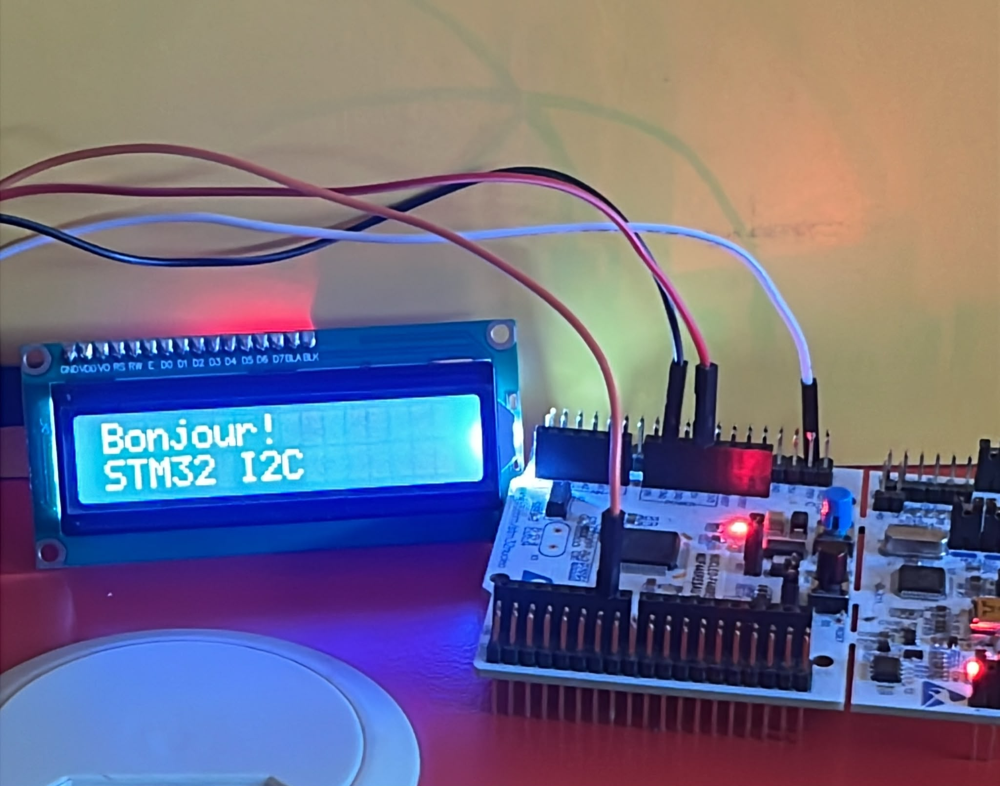

# Apprentissage du Cortex-M4 – STM32F446RE (Nucleo)

Série de projets pour apprendre le **Cortex-M4** de la **STM32F446RE** (carte Nucleo-F446RE) avec le HAL et STM32CubeIDE.


**Auteur : Oponou Emmanuel KOKOLA**

## Matériel et configuration commune

- Carte Nucleo-F446RE
- Horloge : HSI 16 MHz → PLL → SYSCLK **84 MHz** (APB1 = 42 MHz, horloge des timers APB1 = 84 MHz)
- Terminal série : USART2, **115200 bauds**, 8N1
- LED externe avec résistance de 220 à 330 Ω (selon les projets)
- Analyseur logique + PulseView pour vérifier les signaux


## Projets

| Dossier | Périphérique | Notion étudiée |
|---------|--------------|----------------|
| [`LCD_I2C2`](LCD_I2C2) | I2C2 | Afficheur LCD en I2C, mode 4 bits |
| [`Timer6_100ms`](Timer6_100ms) | TIM6 | Base de temps, interruption périodique, calcul PSC / ARR |
| [`Timer_Input_Capture`](Timer_Input_Capture) | TIM2 CH1 + TIM6 | Input Capture, mesure de fréquence |
| [`USART_Interruption`](USART_Interruption) | USART2 | Réception UART par interruption, commandes LED via le terminal |
| [`timer_output_co`](timer_output_co) | TIM2 CH1 | Output Compare, intervalles précis |
| [`timer_pwm_output`](timer_pwm_output) | TIM2 CH1 | PWM, effet « breathing » |


## Compétences démontrées

- **Langage et outils :** C embarqué, HAL STM32, STM32CubeIDE, Git / GitHub
- **Périphériques :** timers (PWM, Output Compare, Input Capture), UART par interruption, I2C
- **Programmation :** gestion par interruptions (sans `HAL_Delay`), calcul de timings (PSC / ARR)
- **Débogage et mesure :** analyseur logique avec PulseView (vérification de signaux, mesure de fréquence)
  

### `LCD_I2C2` : afficheur LCD en I2C

- Bus **I2C2**, afficheur à l'adresse **0x27**, utilisé en **mode 4 bits**.
- Pilote écrit dans `lcd.c` / `lcd.h` (initialisation `LCD_Init`, envoi de commandes et de caractères).
- Résultat : un message s'affiche sur l'écran.




### `Timer6_100ms` : interruption périodique (TIM6)

- Interruption périodique de 100 ms avec `HAL_TIM_Base_Start_IT` et `HAL_TIM_PeriodElapsedCallback`.
- Calcul : `f_interruption = f_timer / ((PSC + 1) × (ARR + 1))`.
- Résultat : LD2 clignote sans `HAL_Delay`.


### `Timer_Input_Capture` : mesure de fréquence

- TIM6 génère un signal carré de **1 kHz** sur PB0 (bascule toutes les 500 µs).
- TIM2 (CH1, PA0) capture les fronts montants : `période = now − prev`, `fréquence = 1 000 000 / période`.
- Câblage de test : **PB0 → PA0**.
- Résultat dans le terminal :
 
**Periode** = 1000 us
**Frequence** = 1000 Hz
  
- Signal vérifié à l'analyseur logique.
  

### `USART_Interruption` : UART en mode interruption

- Réception des caractères avec `HAL_UART_Receive_IT` : le CPU n'attend pas, il est prévenu par une interruption.
- Exercice : commandes **LED ON / LED OFF** envoyées depuis le terminal.
  

### `timer_output_co` : Output Compare

- TIM2 en mode TIMING, PSC = 83 → 1 tick = 1 µs.
- À chaque match, le callback `HAL_TIM_OC_DelayElapsedCallback` ajoute 500 000 ticks à CCR1 → changement d'état toutes les **500 ms** (clignotement à 1 Hz).
- LED externe sur PB0 et message envoyé sur le terminal.

[Voir la démonstration (GIF)](timer_output_co/Timer_outpu_compare.gif)


### `timer_pwm_output` : PWM, effet breathing

- TIM2 en PWM : PSC = 15, ARR = 999 → PWM de 5,25 kHz.
- Le rapport cyclique (CCR1) monte de 0 à 999 puis redescend.
- Broche de sortie : **PA0** (choisie par CubeMX par défaut pour TIM2_CH1) ; PA5 est aussi possible pour LD2.

[Voir l'effet breathing (GIF)](timer_pwm_output/timer_pwm_output.gif)


## Compilation

1. Cloner le dépôt :
```bash
   git clone https://github.com/OponouKOKOLA/STM32_Learning.git
```
2. Dans STM32CubeIDE : **File → Import → Existing Projects into Workspace**, puis choisir le dossier du projet voulu.
3. Compiler avec **Build** (icône marteau), puis flasher la Nucleo avec **Run** (câble USB branché).
4. Pour les projets qui utilisent l'UART : ouvrir un terminal série sur le port de la Nucleo, à **115200 bauds, 8N1**.
   
## Suite prévue

- [ ] **Sur STM32F446RE** (un dossier par projet)
  - [x] Timers
  - [x] UART
  - [x] I2C
  - [ ] SPI
  - [ ] CAN
  - [ ] ADC
  - [ ] DAC
  - [ ] DMA
  - [ ] **RTOS** : FreeRTOS (tâches, files d'attente, sémaphores, mutex), puis Zephyr
  
- [ ] **Communication sans fil** : LoRaWAN, puis Zigbee
- [ ] **Passage à Nordic** : mêmes notions (timers, UART, I2C...) avec Zephyr
